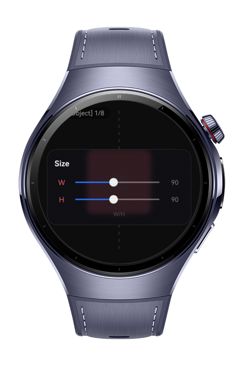
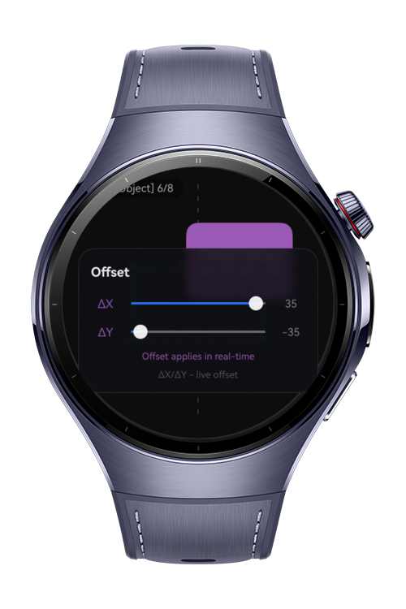
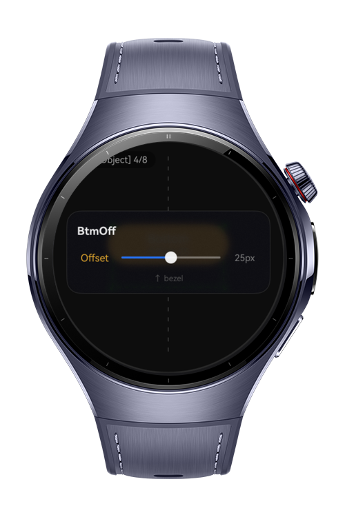
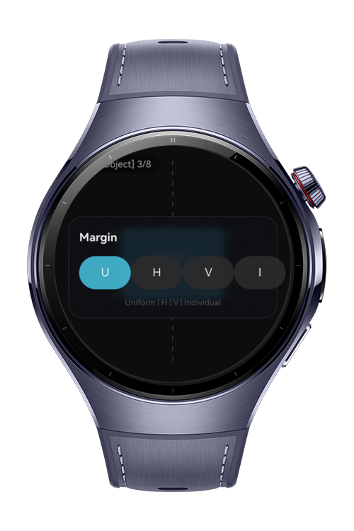

> **Note:** To access all shared projects, get information about environment setup, and view other guides, please visit [Explore-In-HMOS-Wearable Index](https://github.com/Explore-In-HMOS-Wearable/hmos-index).

# How To Build Layout Sizing Position 

A professional layout debugging tool for HarmonyOS wearable developers that visualizes how 8 different ArkUI layout modules behave on round smartwatch displays.

# Preview

<div>
  
  
  
  

</div>

# Use Cases

- **Debug UI clipping** on round watch displays with real-time bounding box visualization
- **Test layout behavior** of 8 different ArkUI modules (Size, Sizing, MarginType, BottomOffset, Position, Offset, Location, Safe Area)
- **Validate component positioning** before deploying to physical Huawei Watch devices
- **Educational tool** for understanding how ArkTS layout properties interact on circular viewports
- **Rapid prototyping** of watch face complications with absolute and relative positioning
- **Safe area verification** to ensure content stays visible within curved bezel boundaries

# Technology

## Stack

| Category | Technology |
|----------|------------|
| **Language** | ArkTS (TypeScript superset) |
| **Framework** | ArkUI (HarmonyOS UI) |
| **Minimum API** | HarmonyOS API 9+ |
| **Target Platform** | Wearable (Round Display) |
| **Build Tool** | hvigor |
| **IDE** | DevEco Studio 3.1+ |
| **State Management** | @Provide / @Consume |
| **Rendering** | Canvas API + ArkUI Components |

## Required Permissions

| Permission | Purpose |
|------------|---------|
| `ohos.permission.VIBRATE` | Haptic feedback for user interactions (module switching, resets) |

# Directory Structure

```

├── ets/
│   ├── pages/
│   │   └── CalibrationPage.ets      # Main container, navigation
│   ├── components/
│   │   ├── TopBar.ets               # Module indicator
│   │   ├── BottomPanel.ets          # Control panel with sliders
│   │   ├── TestComponent.ets        # Visual test component
│   │   └── DebugOverlay.ets         # Canvas bounding box
│   ├── model/
│   │   └── LayoutState.ets          # Shared reactive state
│   └── utils/
│       └── GeometryUtils.ets        # Clipping detection
└── resources/
    └── base/
        └── element/
            ├── color.json           # Color constants
            ├── string.json          # Text constants
            └── float.json           # Dimension constants

```

# Constraints and Restrictions

## Supported Device

* Huawei Watch 4 Series
* Huawei Watch 5 Series
* Circular Screen Wearables (UI optimized via `.clip` and `.width/height` constraints)

# License

**How To Build Layout Sizing Position** is distributed under the terms of the MIT License.
See the [LICENSE](./LICENSE) for more information.